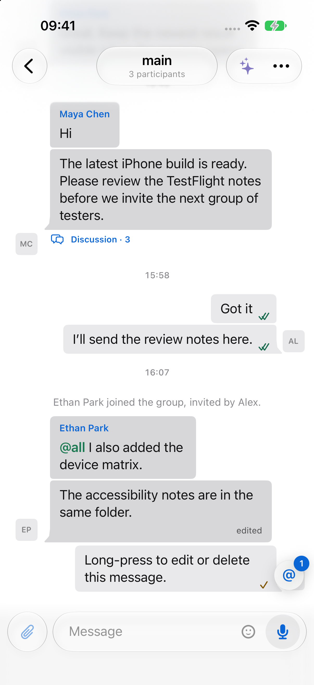
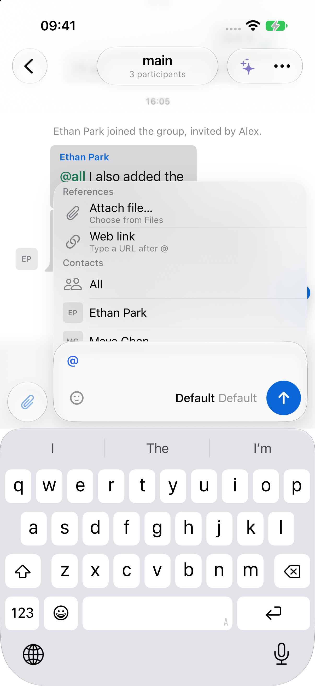

# Compact glass composer

Native iPhone simulator captures of the complete conversation page using synthetic preview data. These are screenshots of the SwiftUI implementation, not a browser recreation.

The mention panel extends behind the input while retaining the input's independent glass material and border. References, Contacts, and Agents keep their existing selection actions, with dense rows and square avatars. The microphone stays inside the input and transitions to Send while typing. Request cancellation remains on the message row.

| Composer | Mention menu |
| --- | --- |
|  |  |

Captures retain their native 1206 × 2622 resolution. Light and dark appearances and the focus, typing, clearing, and keyboard dismissal transitions were reviewed locally. Reduced Motion disables the new transitions; Reduced Transparency uses an opaque menu surface.

For offline reproduction, launch a Debug-enabled Kordi Beta simulator build with `--preview-data --preview-native-design`. Add `--preview-composer-mentions`, `--preview-composer-stop`, or `--preview-composer-typing` for the corresponding synthetic state. The typing flag scripts a draft locally without sending a message.
